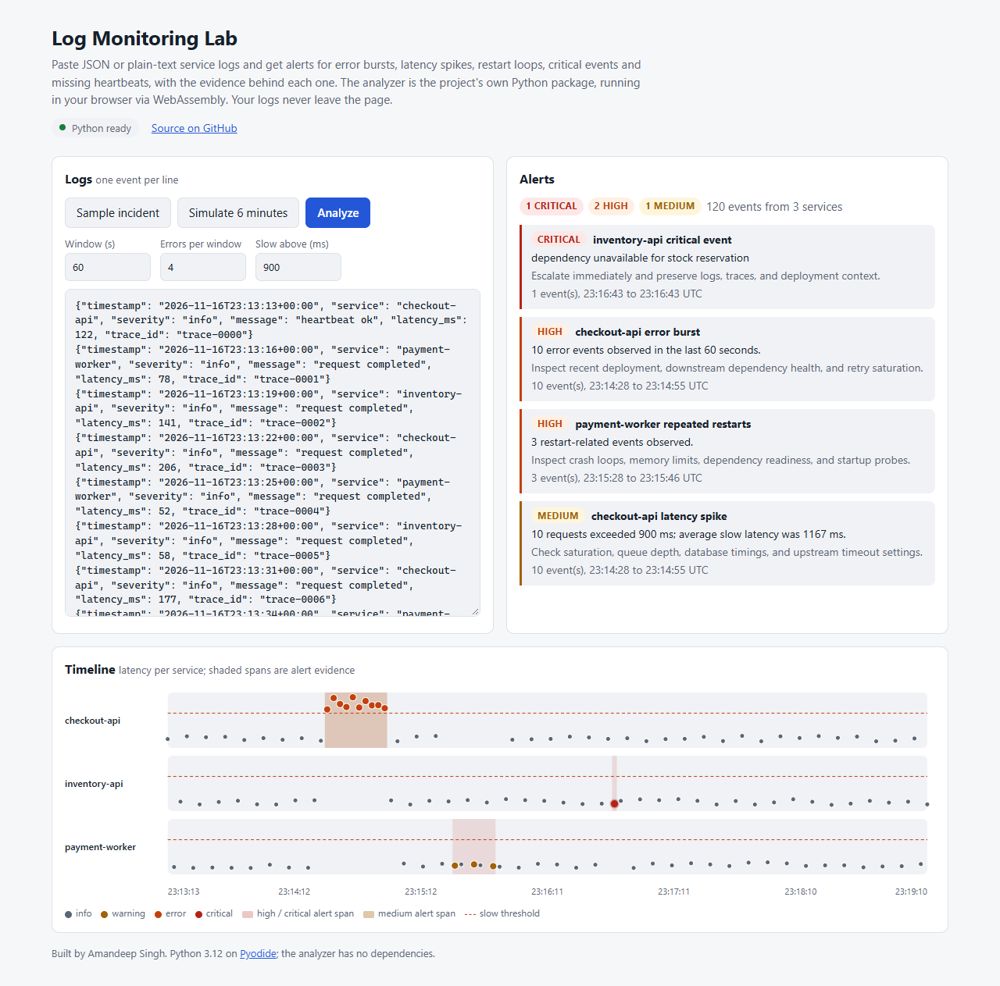

# Distributed Log Monitoring and Alerting System

[](https://github.com/amandesi13/distributed-log-monitoring-alerting-system/actions/workflows/ci.yml)
[](https://amandesi13.github.io/distributed-log-monitoring-alerting-system/)
[](https://www.python.org/)
[](pyproject.toml)
[](LICENSE)

**[Live demo](https://amandesi13.github.io/distributed-log-monitoring-alerting-system/)**: paste logs or simulate an incident and watch the alerts and timeline update. The real analyzer runs client-side on Pyodide (WebAssembly), so logs never leave the browser.

[](https://amandesi13.github.io/distributed-log-monitoring-alerting-system/)

A Python-based observability lab for collecting service logs, detecting operational anomalies, and raising clear alerts from noisy runtime signals.

The project models the kind of troubleshooting workflow used in distributed Linux services: parse logs, group them by service, watch error and latency patterns, simulate failures, and emit actionable alerts that can be used locally, in Docker, or in Kubernetes.

## What It Does

- Parses JSON and plain-text service logs into structured events.
- Tracks rolling windows per service.
- Detects common operational issues:
  - error bursts
  - latency spikes
  - missing heartbeat events
  - repeated service restarts
  - critical log entries
- Generates service-level alerts with severity, evidence, and remediation hints.
- Includes a simulator for failure scenarios.
- Ships with Docker, Kubernetes manifests, sample logs, and unit tests.

## Quick Start

```powershell
python -m venv .venv
.\.venv\Scripts\python.exe -m pip install -e .[dev]
.\.venv\Scripts\python.exe -m log_monitoring analyze samples\service.log
```

On macOS/Linux:

```bash
python -m venv .venv
. .venv/bin/activate
python -m pip install -e ".[dev]"
python -m log_monitoring analyze samples/service.log
```

## Example

```bash
python -m log_monitoring analyze samples/service.log --format text
```

Example alert:

```text
[HIGH] checkout-api error burst
5 error events observed in the last 60 seconds.
Hint: inspect recent deployment, downstream database health, and retry saturation.
```

## Simulate Failures

Generate a synthetic log stream with intermittent failures:

```bash
python -m log_monitoring simulate --output reports/simulated.log --events 120
python -m log_monitoring analyze reports/simulated.log
```

## Docker

```bash
docker build -t distributed-log-monitoring .
docker run --rm distributed-log-monitoring analyze samples/service.log
```

## Kubernetes

The `k8s/` folder contains a ConfigMap-driven Job that analyzes a mounted sample log file. It is intentionally small so the behavior is easy to inspect:

```bash
kubectl apply -f k8s/log-monitor-job.yaml
```

## Project Structure

```text
src/log_monitoring/
  alerts.py       alert objects and sinks
  analyzer.py     rolling-window anomaly detection
  cli.py          command-line interface
  collector.py    file collection helpers
  models.py       typed domain objects
  parser.py       JSON and text log parsing
  simulator.py    synthetic service log generation
tests/
  test_analyzer.py
  test_parser.py
samples/
  service.log
k8s/
  log-monitor-job.yaml
```

## Why This Project Matters

Distributed systems often fail through patterns rather than single events: a few retries become a latency spike, a dependency starts returning errors, or a service stops sending heartbeats. This project demonstrates how structured parsing and deterministic anomaly detection can turn logs into practical operational signals.

## Browser demo

`web/` holds a static page that loads this package into [Pyodide](https://pyodide.org) and calls
`web/bridge.py` (strings in, JSON out; covered by `tests/test_web_bridge.py`). Unparseable lines are
reported with their line number and skipped. The `demo` workflow builds the site with
`python web/build_site.py` and deploys it to GitHub Pages on every push to `main`.

```bash
python web/build_site.py _site
python -m http.server -d _site 8000   # http://localhost:8000
```
